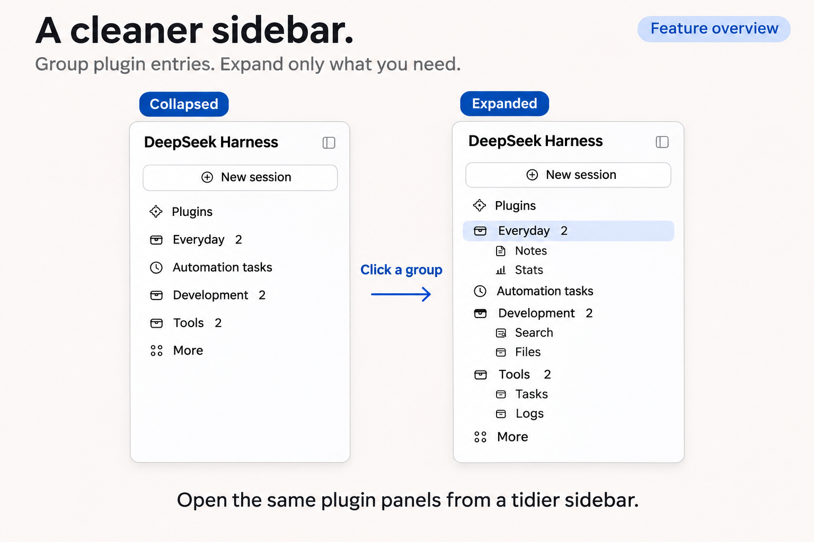
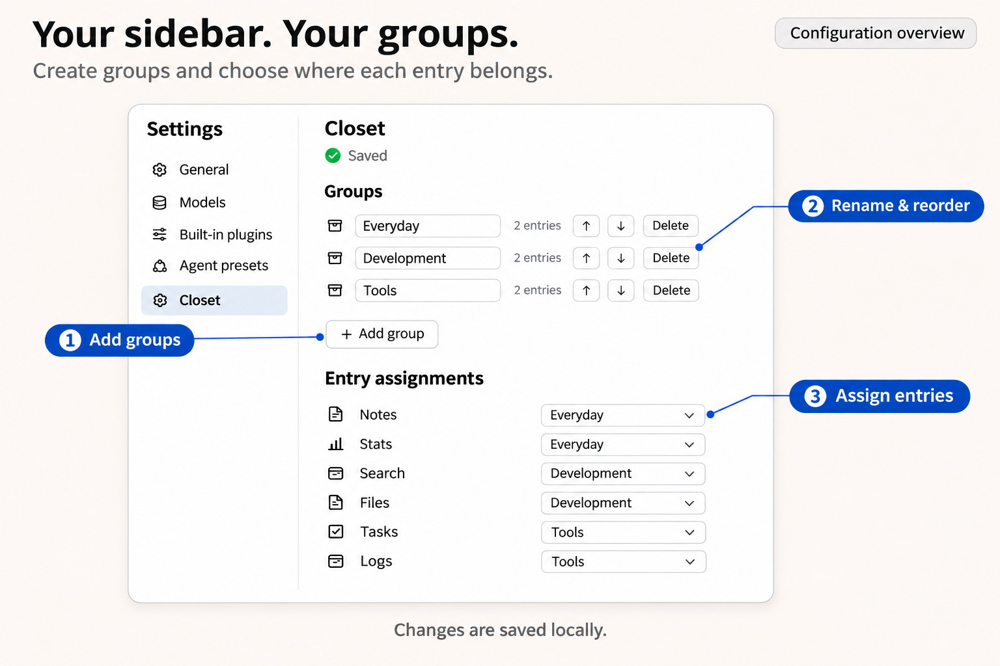

# dsh-closet

Collapsible sidebar groups for DeepSeek Harness.

**English** · [简体中文](README.zh.md) · [Download v0.1.4](https://github.com/SamLeRiddle/dsh-closet/releases/tag/v0.1.4) · [Changelog](CHANGELOG.md)



## Features

- **Independent groups.** Create multiple groups and expand or collapse each one separately.
- **Original plugin panels.** Open panels through their grouped entries, with active-entry highlighting and collapsed-group indicators.
- **Flexible organization.** Rename and reorder groups, move entries between them, or return entries to the sidebar.
- **Automatic updates.** Available entries and counts follow plugin enable/disable changes, while saved assignments are retained.
- **Local persistence.** Changes save automatically. Failed saves preserve pending edits and offer a retry.

## Installation

1. Download a ZIP or TGZ from the [release page](https://github.com/SamLeRiddle/dsh-closet/releases/tag/v0.1.4).
2. Install the extracted `dsh-closet` directory or the TGZ as a local DSH bundle.
3. Restart DSH as required by the host.

For Windows Desktop, use its bundled CLI or supported plugin manager with the `desktop` profile.

Back up `<DSH_HOME>/config/dsh-closet.json` before upgrading. Existing valid configurations remain compatible. If an older version grouped official sidebar entries, return them to the sidebar before upgrading; existing records are not automatically removed.

## Configuration

Open DSH settings and select **匣**.

1. Create groups and give them names that fit your workflow.
2. Use each entry’s dropdown to choose its group or leave it ungrouped.
3. Reorder groups with the arrow buttons. Deleting a group returns its members to the sidebar.



Settings are saved to `<DSH_HOME>/config/dsh-closet.json`, defaulting to `~/.dsh/config/dsh-closet.json`. Saves are processed in order, with pending edits combined into the latest state.

Temporary read failures leave the original configuration untouched. Invalid JSON is backed up before rebuilding, and existing `.broken` backups are preserved.

## Compatibility

The runtime has been tested with Windows 11 and DSH Desktop **0.2.2-rc.1**. Version 0.1.4 fixes official sidebar entries being incorrectly listed for assignment in the English host interface.

Current limitations:

- The plugin settings UI is in Chinese; full English localization is not included.
- Entries are identified by their labels. Identical labels cannot be distinguished reliably, and renamed or translated entries may need reassignment. Groups use separate IDs and may share names.
- Menu entries and some entries using the host’s default icon are excluded from grouping.
- The implementation depends on the host’s sidebar structure. DSH updates may require compatibility changes.

## Advanced configuration

To change the default `/closet` API prefix, add an override in your profile’s `cordis.patch.yml`:

```yaml
- id: closet
  config:
    routePrefix: /custom
```

Restart DSH and refresh the page. The host and client will both use `/custom/api/config`. Nested paths such as `/tools/closet` and the root prefix `/` are also supported.

## Development

Run the regression suite from the plugin directory:

```sh
npm test
```

The release passed 23 regression tests. Tested environments and runtime fingerprints are documented in the [Windows validation notes](WINDOWS-VALIDATION.md).

## License

[MIT](LICENSE)
