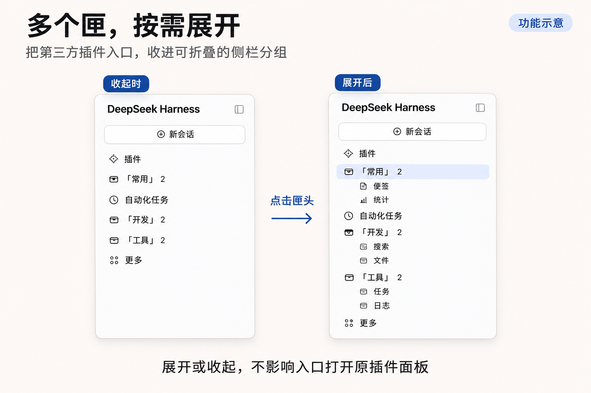
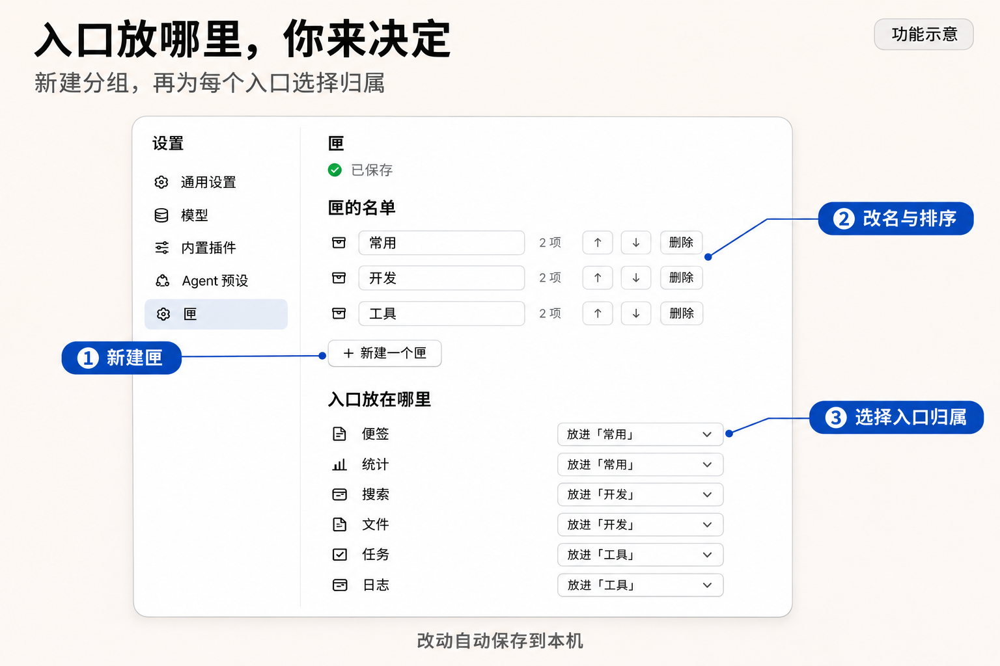

# 匣（dsh-closet）

把 DeepSeek Harness 侧栏里零碎的第三方插件入口，收进一个可折叠的小盒子。

> **0.1.3 预发布**：Linux DSH Web 已验证；Windows Desktop 尚待本版验收。安装包与 Windows 测试材料见 [Release](https://github.com/SamLeRiddle/dsh-closet/releases/tag/v0.1.3)。





图中以「常用」「开发」「工具」三个匣为例，展示侧栏收纳和设置入口归属的方式。

## 它做什么

- 侧栏「插件」区多出一行 **匣**（直身匣线稿图标）。点一下，收在里面的入口在它下面展开；再点，收起。
- 匣里的入口点了就打开对应面板，正在看的那项会浅浅高亮；匣收着但里面正被使用时，图标上有个小圆点提示。
- 被收进匣的原始侧栏行不再单独占位置（只是隐藏，插件本身不受影响）。
- 官方那几行（插件、自动化任务、更多）不参与搬运。

## 怎么配置

不需要改代码。装好后打开 **设置 → 匣**：

- 新建、改名、排序、删除匣（删除时里面的入口自动回到匣外，不会丢）。
- 每个第三方入口用下拉框决定放进哪个匣、还是放回外面；列表自动发现侧栏上现有的第三方入口。
- 新装的插件默认在匣外，随时可以收进来。

设置保存在本机 `<DSH_HOME>/config/dsh-closet.json`（默认 `~/.dsh/config/dsh-closet.json`），只在这台电脑上，不联网。写文件用「临时文件 + 改名」的原子方式。只有文件不存在时才创建默认配置；权限、占用或其他读取错误会显示读取失败并支持重试，不移动或重写原文件。确实无法解析的 JSON 会先备份为 `.broken` 再重建；已有备份会保留，后续备份依次使用 `.broken.1` 等名称。备份失败时也只报错，不重建默认配置。

改动会立即反映在界面上，并按顺序保存。连续操作时，等待中的改动会合并为最新设置。设置页会显示「保存中…」或「已保存」；保存失败时会显示错误，保留当前改动，并提供「重试保存」。刷新页面会重新读取已经落盘的设置。

接口默认前缀为 `/closet`。如需更改，在 profile 的 `cordis.patch.yml` 中覆盖本插件配置：

```yaml
- id: closet
  config:
    routePrefix: /custom
```

更改后重启 DSH 并刷新页面。Host 会通过 DSH 的页面配置注入，把前缀传给界面；读取和保存将使用同一个地址（此例为 `/custom/api/config`）。前缀也可以是 `/tools/closet` 这样的多级路径，或 `/`（对应 `/api/config`）。

## 它是怎么做到的（也说清代价）

DSH 的侧栏没有官方的「分组」接口，所以：

1. 匣头和匣内每一项注册成**本插件自己的侧栏行**；点击在页面最外层截住，转去程序化点击被隐藏的原行，从而打开真正的面板——所以不需要知道每个面板的 id，只要侧栏行还在就能转。
2. 被收进去的原行，用一条按 `aria-label` 匹配的样式隐藏。
3. 展开/收起用 `<html data-closet-…>` 属性加样式实现。

**代价**：这套是「借道」，不是官方接口。宿主改了侧栏结构（行类名、`aria-label`、文案）就要跟着调。目前按中文界面识别官方行与入口文案，**暂未适配英文等其他界面语言**（英文界面下官方行可能被误认为第三方入口，不确定就别收它，随时可在设置里放回匣外）。

入口目前按显示标签识别：同名插件入口无法可靠区分；插件入口改名或切换语言后，原归属可能匹配不上，需要重新分配。两个匣本身可以同名，彼此仍按 ID 区分。

## 文件

- `lib/index.js` — Host 半边：配置的本地读写 + 同源 JSON 接口（`<prefix>/api/config`，GET 读 / POST 写，带请求校验与 256KB 上限）。
- `lib/ui.js` — 界面代码（侧栏行、设置页，经 `window.__ModuleLoader__.load` 加载）。
- `lib/client.js` — 空实现（纯界面插件）。
- `tests/` — 保存队列、错误重试、前缀传递与配置接口的回归测试；运行 `npm test`。

## 安装

把本目录作为 bundle 安装进 DSH（可用插件市场装本地目录，或链接进 profile 的 bundles），重启或刷新页面后生效。

## 0.1.3 更新

- 配置临时读取失败时返回错误并保留原文件，避免把有效配置当作损坏文件重建为空匣。
- 损坏 JSON 只有在备份成功后才重建，且不覆盖已有 `.broken` 备份。
- 改名时按 Esc 会取消编辑，不触发失焦保存，也不会连带关闭设置页；正常失焦和 Enter 保存保持可用。
- 新增读取失败、恢复重试、损坏配置备份及 Esc 取消的回归测试。

## 0.1.2 更新

- 修复：插件停用后，匣内那一行不再残留成点不动的死行——只画侧栏上确实还在的入口，匣上的数字同步减少。
- 侧栏行增删（插件启用/停用）时自动重新对齐，不需要刷新页面。
- 停用插件的入口记录仍保留在配置里，插件重新启用后自动回到原来的匣。
- 匣里若还有「找不到的入口」，匣内容面板会提示「另外 N 个入口在侧栏里找不到（插件可能停用了）」；设置页也会标记对应入口未找到。

## 0.1.1 更新

- 保存请求串行执行，等待中的改动合并为最新快照，较早的响应不再覆盖后续操作。
- 保存失败时显示明确提示，支持重试当前未保存的设置。
- 自定义 `routePrefix` 同时应用于 Host 和界面。
- 展开或收起匣时保留已有侧栏注册，避免重复注销和创建入口。

升级保留现有 `dsh-closet.json`，配置文件格式仍为版本 1。0.1.2 的交付记录注明已在 DSH Web `0.2.1-rc.5` 和 DSH Desktop `0.2.2-rc.1`（Windows nightly）做界面验收。0.1.3 的新增修复在 Linux DSH Web 上补测，包含真实读取权限失败、重试恢复、Esc 取消及动态启停；本次未运行 Windows Desktop。

## 许可

[MIT](./LICENSE)
