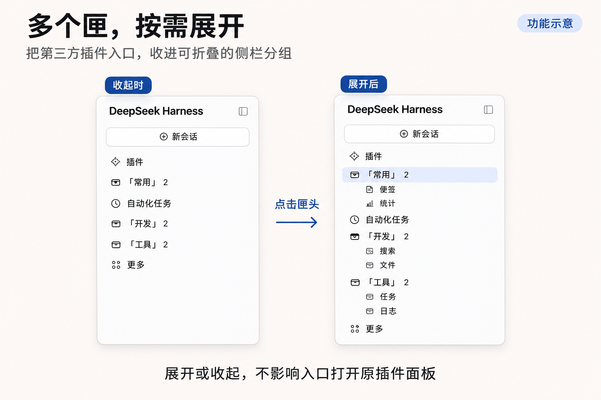
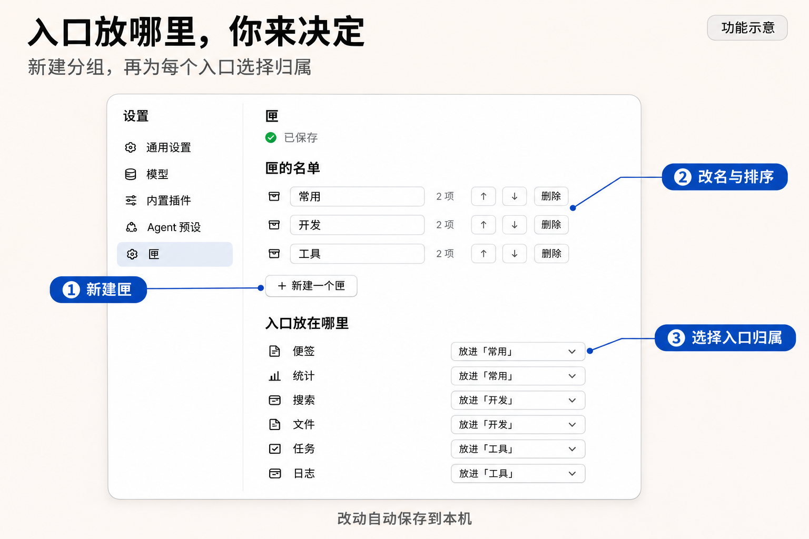

# 匣 · dsh-closet

为 DeepSeek Harness 侧栏提供可折叠的插件分组。

[English](README.md) · **简体中文** · [下载 v0.1.4](https://github.com/SamLeRiddle/dsh-closet/releases/tag/v0.1.4) · [更新记录](CHANGELOG.md)



## 功能

- **独立分组**：创建多个匣，每个匣可单独展开或收起。
- **打开原面板**：从匣内入口打开对应插件面板，支持当前入口高亮与收起后的活动标记。
- **自由整理**：改名、排序、跨匣移动，或将入口放回侧栏。
- **自动更新**：插件启停后，入口和数量跟随侧栏变化；原有归属记录保留。
- **本地保存**：设置自动落盘，保存失败保留当前编辑并支持重试。

## 安装

1. 在 [发布页面](https://github.com/SamLeRiddle/dsh-closet/releases/tag/v0.1.4) 下载 ZIP 或 TGZ。
2. 将 ZIP 解压后的 `dsh-closet` 目录或 TGZ 作为本地 DSH bundle 安装。
3. 按宿主要求重启 DSH。

Windows Desktop 请使用自带 CLI 或当前版本支持的插件管理器，并选择 `desktop` profile。

升级前备份 `<DSH_HOME>/config/dsh-closet.json`。已有有效配置可继续使用。如果旧版曾将官方入口收进匣，请先放回侧栏；本版不会自动清理已有记录。

## 配置

打开 DSH **设置 → 匣**：

1. 新建匣，并按使用习惯命名。
2. 通过入口右侧的下拉框选择归属，也可以留在匣外。
3. 使用箭头调整顺序。删除匣时，成员会回到侧栏。



设置保存在 `<DSH_HOME>/config/dsh-closet.json`，默认路径为 `~/.dsh/config/dsh-closet.json`。保存按顺序执行，等待中的编辑合并为最新状态。

暂时读取失败时保留原配置；无效 JSON 在成功备份后才重建，已有 `.broken` 备份继续保留。

## 兼容性

运行代码已在 Windows 11、DSH Desktop **0.2.2-rc.1** 环境测试。0.1.4 修复了英文宿主界面下官方入口被错误列入可分配列表的问题。

当前限制：

- 插件设置界面仍为中文，尚未完成英文界面本地化。
- 入口按标签识别，同名入口无法可靠区分；改名或切换语言后，可能需要重新分配。匣本身按 ID 区分，可以同名。
- 菜单入口及部分使用宿主默认图标的入口不参与收纳。
- 实现依赖宿主的侧栏结构，DSH 更新后可能需要适配。

## 高级配置

默认 API 前缀为 `/closet`。如需修改，在 profile 的 `cordis.patch.yml` 中添加覆盖配置：

```yaml
- id: closet
  config:
    routePrefix: /custom
```

重启 DSH 并刷新页面后，Host 与界面均使用 `/custom/api/config`。也支持 `/tools/closet` 等多级路径，以及根前缀 `/`。

## 开发

在插件目录运行回归测试：

```sh
npm test
```

当前发布版本已通过 23 项回归测试。具体环境与运行代码指纹见 [Windows 验证摘要](WINDOWS-VALIDATION.md)。

## 许可

[MIT](LICENSE)
